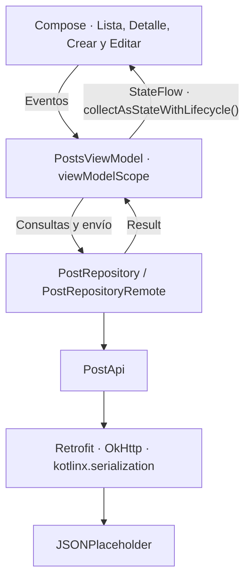
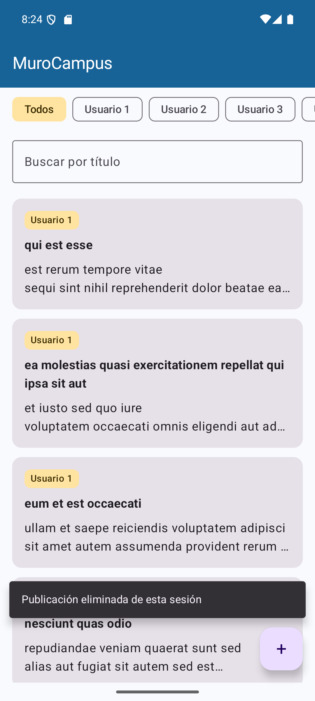
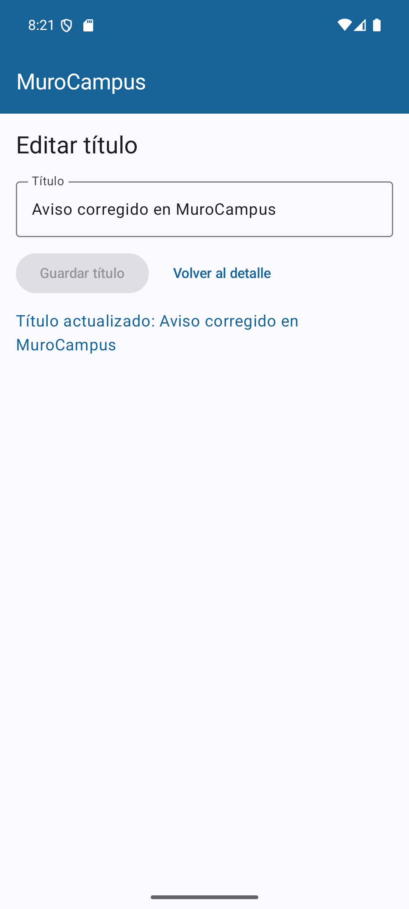
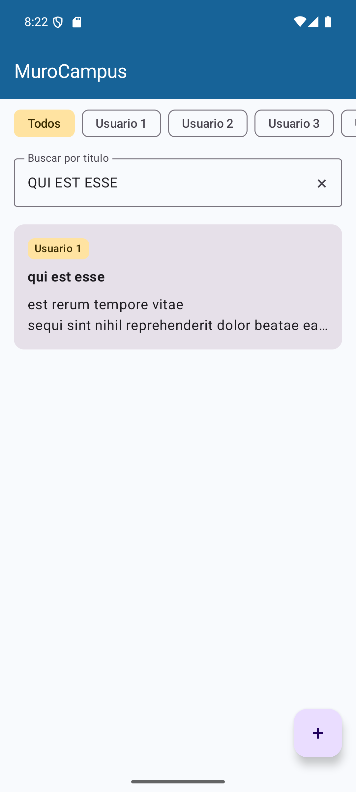
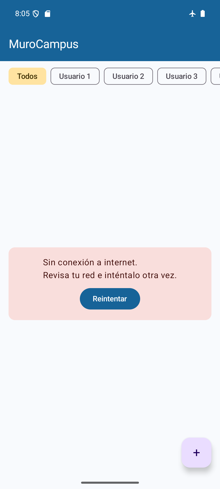

# MuroCampus IA

Versión de la Fase 2 de MuroCampus, basada en el árbol del proyecto del commit `32443c4`. Conserva la consulta de publicaciones y comentarios, el filtro por usuario y la creación. Añade eliminación, edición del título y búsqueda local.

**Asistencia de IA.** El proyecto base del docente no estaba disponible. Codex reconstruyó la base e implementó, probó y documentó esta versión de la Fase 1 con autorización del usuario. Por ello, esta versión es asistida y no cumple la condición académica de trabajo sin IA de la guía. [Origen de la base](BASE.md)

Esta fase se implementó con Codex. El [registro de prompts](PROMPTS.md) recoge la solicitud real y qué implementó la IA.

## Ejecución

Abre esta carpeta en Android Studio, sincroniza Gradle y ejecuta el módulo `app` en `Pixel_8` (API 35) o un dispositivo compatible. La compilación usa Gradle 8.9, AGP 8.7.2, Kotlin 2.0.21 y SDK 35.

La aplicación se instala como **MuroCampus IA** (`com.tecsup.murocampus.ia`). Puede convivir en el emulador con la Fase 1, y ambas muestran la barra «MuroCampus».

En Windows, puedes ensamblar el APK de depuración con `.\gradlew.bat :app:assembleDebug`. La aplicación necesita conexión a internet. OkHttp registra el tráfico de la API en Logcat solo en compilaciones de depuración. Usa datos de práctica en el formulario.

## Paquetes

```text
com.tecsup.murocampus
├── MainActivity.kt
├── model
│   └── Modelos.kt
├── data
│   ├── PostRepository.kt
│   ├── UsuarioRepository.kt
│   └── remote
│       ├── PostApi.kt
│       ├── RetrofitClient.kt
│       └── UsuarioApi.kt
├── viewmodel
│   ├── PostsViewModel.kt
│   ├── PostsViewModelFactory.kt
│   └── UiState.kt
└── ui
    ├── Componentes.kt
    ├── PantallaLista.kt
    ├── PantallaDetalle.kt
    ├── PantallaCrear.kt
    ├── PantallaEditar.kt
    └── theme
        └── Theme.kt
```

## Arquitectura MVVM + Repository



La actividad construye e inyecta el repositorio. La vista observa `Cargando`, `Exito` o `Error` y emite eventos. El repositorio traduce fallos de conexión, HTTP y serialización y relanza `CancellationException`. El ViewModel cancela las solicitudes reemplazadas y la carga del detalle al volver a la lista.

## Mejoras de la Fase 2

- **Eliminar.** En el detalle, pulsa «Eliminar» y confirma. El repositorio comprueba el estado HTTP de `DELETE posts/{id}` con `Response<Unit>`. Tras un 2xx, la app vuelve a la lista, retira la publicación y muestra la confirmación. Si falla, conserva la publicación y permite volver a intentar.
- **Editar título.** En «Editar título», el formulario carga el título actual. Guarda un título distinto y no vacío mediante `PATCH posts/{id}`. El cuerpo contiene únicamente `title`. La pantalla muestra el título devuelto y lo refleja en la lista y el detalle.
- **Buscar por título.** Escribe en «Buscar por título». La búsqueda compara fragmentos sin distinguir mayúsculas y trabaja sobre las publicaciones descargadas del filtro activo. El botón de limpiar restaura ese conjunto y «Sin coincidencias» indica que la consulta no encontró títulos.

JSONPlaceholder responde a las mutaciones, pero no las almacena. El ViewModel conserva en memoria los títulos corregidos y las publicaciones retiradas de esta sesión, incluso al cambiar el filtro. Al reiniciar la app se recupera el estado original del servidor.

### Evidencias de la Fase 2 en Pixel_8

| Eliminar con confirmación del servidor | Editar el título | Buscar por título |
|---|---|---|
|  |  |  |

### Pruebas de la Fase 2

| Prueba | Resultado observado |
|---|---|
| DELETE | Cancelar el diálogo no envió la solicitud. Sin red, el detalle conservó la publicación y mostró el error. Al confirmar con red, el servidor devolvió HTTP 200 y la publicación desapareció de la lista de la sesión. El filtro respetó la eliminación y al reiniciar reapareció el dato original. |
| PATCH | Guardar estuvo deshabilitado con título vacío o idéntico al actual. Un fallo de conexión conservó el borrador. Logcat registró el envío de solo `title` y HTTP 200 con el título actualizado. El título se reflejó al cambiar de filtro y al reabrir el detalle, y recuperó el valor original al reiniciar. |
| Búsqueda | `QUI EST ESSE` encontró `qui est esse` sin conexión y sin otro GET. Conservó la consulta al abrir el detalle y al rotar. Con el usuario 2 mostró «Sin coincidencias», y al limpiar la consulta reaparecieron sus publicaciones. |
| Regresión | En el APK final pasaron lista y rotación, detalle y vuelta rápida, diez filtros, creación con HTTP 201 e id 101 y errores de conexión con reintento. Las variantes temporales comprobaron carga, HTTP 404, lista vacía y JSON inesperado. Tras restaurarlas se volvió a compilar e instalar el APK final. |

## Capturas de la Fase 1 en Pixel_8

| Lista | Detalle | Filtro por usuario |
|---|---|---|
|  |  |  |

| Creación | Error de conexión |
|---|---|
|  |  |

## Verificaciones de la Fase 1

| Prueba | Resultado observado |
|---|---|
| Compilación e inicio | APK de depuración compilado e instalado en Pixel_8 (API 35). |
| Lista y rotación | Una prueba con latencia inducida mostró el indicador circular y el texto de carga. El servidor devolvió 100 publicaciones. Al rotar se conservó la lista y Logcat no registró otro GET de la lista. |
| Detalle y vuelta a la lista | Las publicaciones 1, 2 y 3 devolvieron cinco comentarios cada una. Atrás regresó a la lista sin recargarla. |
| Filtro | Los usuarios 1 a 10 devolvieron diez publicaciones del usuario elegido. Todos volvió a las 100. Una consulta temporal para el usuario 9999 devolvió una lista vacía y se mostró `Sin publicaciones`. |
| Publicación | Publicar estuvo deshabilitado con campos vacíos. Un fallo de red conservó el borrador. La respuesta real HTTP 201 devolvió el id 101 y se limpiaron los campos. |
| Conexión y reintento | Con modo avión y Wi-Fi desactivado se mostró el error en la lista y en el detalle. Con la conectividad restaurada, Reintentar recuperó ambas pantallas. |
| HTTP 404 | En una compilación de prueba que consultó temporalmente `posts/9999`, el detalle mostró `Error del servidor (404)` y Reintentar. |
| JSON inesperado | Con una clave del JSON desconocida para el modelo, la lista cargó. Con un campo obligatorio adicional, la pantalla mostró `Respuesta inesperada`. |
| Cancelación | Abrir y volver rápidamente del detalle dejó la lista en pantalla sin errores fatales en Logcat. Se verificó en el código el relanzamiento de la cancelación y la cancelación del trabajo activo. |

Los cambios temporales de latencia, 404, filtro vacío y variaciones del JSON se restauraron antes de compilar la versión final.

## Para pensar

1. **GET y POST.** GET pide una representación del recurso. POST envía datos para crear una publicación. `@Body` lleva el JSON de `NuevoPost` en el cuerpo. `@Query` agrega `userId` a la URL para limitar el resultado de un GET.
2. **Rutas relativas.** `posts` se resuelve con respecto a la URL base y conserva su ruta. Una barra inicial hace que la resolución comience desde la raíz del host. Con la URL base de este laboratorio producen la misma URL, pero la diferencia importa si la API está, por ejemplo, bajo `/api/`.
3. **Result en el repositorio.** El repositorio resuelve los fallos propios de la fuente de datos. El ViewModel puede transformar el resultado en un estado de UI sin depender de excepciones de Retrofit. La cancelación se propaga para detener la corrutina.
4. **Permiso y claves desconocidas.** Sin `INTERNET`, Android impide abrir conexiones aunque el proyecto compile. Sin `ignoreUnknownKeys`, un campo nuevo del servidor que el modelo no conoce puede provocar un error de deserialización. Un campo requerido ausente falla aunque se ignoren claves desconocidas.
5. **Un único estado de UI.** `UiState` hace mutuamente excluyentes la carga, los datos y el error. Un `when` exhaustivo obliga a manejar cada caso y evita combinaciones incoherentes de variables.
6. **API con persistencia.** JSONPlaceholder confirma la creación, pero la lista que se descarga después no incluye ese cambio. Con una API real, actualizaría la lista a partir de la respuesta confirmada o volvería a consultarla para obtener datos persistidos, conservando el filtro activo.
