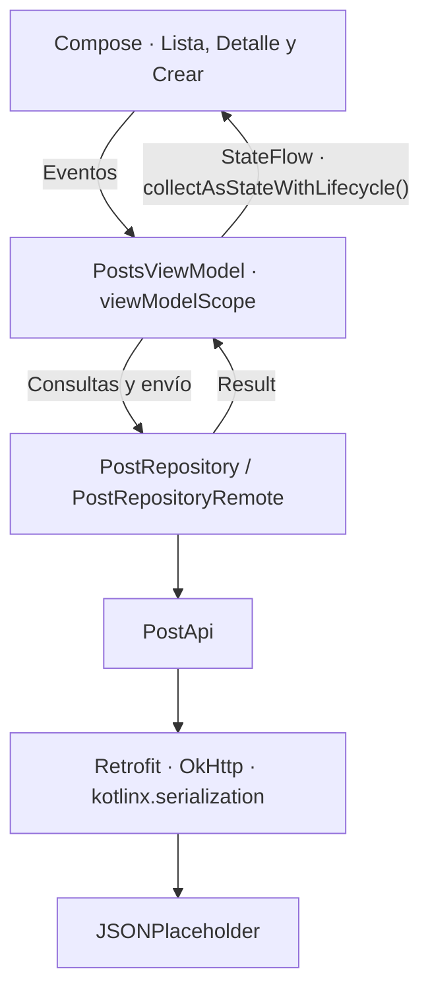
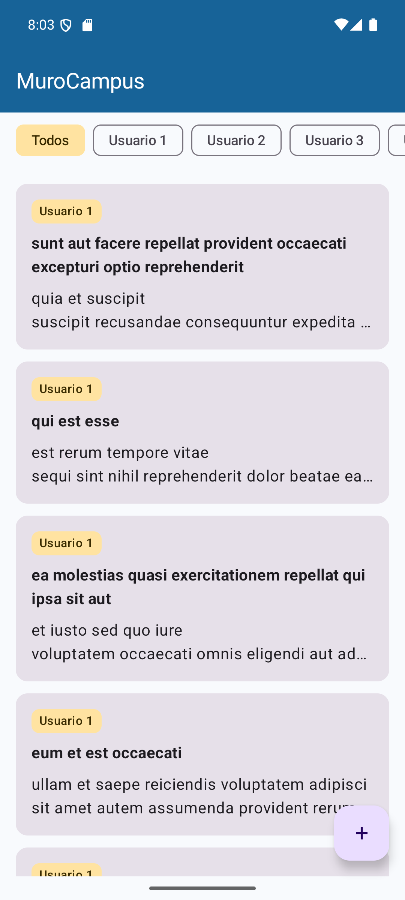
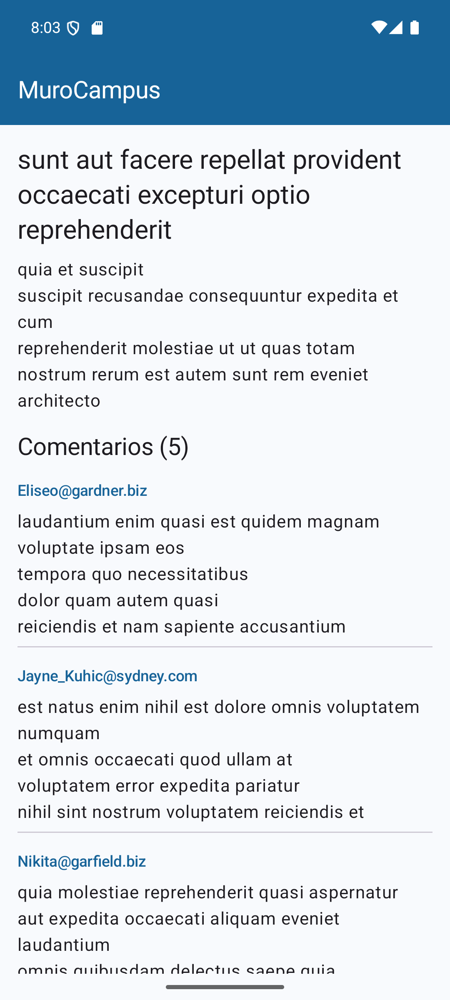
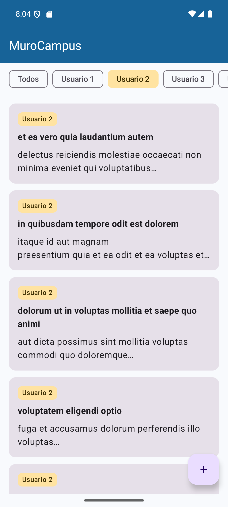
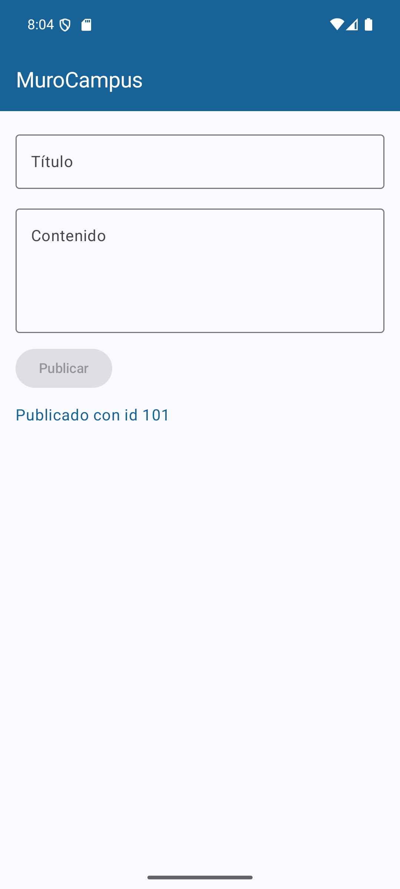

# MuroCampus

Aplicación Android en Kotlin y Jetpack Compose para consultar publicaciones de JSONPlaceholder, leer sus comentarios, filtrar por usuario y enviar una publicación de práctica.

**Asistencia de IA.** El proyecto base del docente no estaba disponible. Codex reconstruyó la base e implementó, probó y documentó esta versión de la Fase 1 con autorización del usuario. Por ello, esta versión es asistida y no cumple la condición académica de trabajo sin IA de la guía. [Origen de la base](BASE.md)

## Ejecución

Abre esta carpeta en Android Studio, sincroniza Gradle y ejecuta el módulo `app` en `Pixel_8` (API 35) o un dispositivo compatible. La compilación usa Gradle 8.9, AGP 8.7.2, Kotlin 2.0.21 y SDK 35.

En Windows, puedes ensamblar el APK de depuración con `.\gradlew.bat :app:assembleDebug`. La aplicación necesita conexión a internet. OkHttp registra el tráfico de la API en Logcat solo en compilaciones de depuración. Usa datos de práctica en el formulario.

## Paquetes

```text
com.tecsup.murocampus
├── MainActivity.kt
├── model
│   └── Modelos.kt
├── data
│   ├── PostRepository.kt
│   ├── UsuarioRepository.kt
│   └── remote
│       ├── PostApi.kt
│       ├── RetrofitClient.kt
│       └── UsuarioApi.kt
├── viewmodel
│   ├── PostsViewModel.kt
│   ├── PostsViewModelFactory.kt
│   └── UiState.kt
└── ui
    ├── Componentes.kt
    ├── PantallaLista.kt
    ├── PantallaDetalle.kt
    ├── PantallaCrear.kt
    └── theme
        └── Theme.kt
```

## Arquitectura MVVM + Repository



La actividad construye e inyecta el repositorio. La vista observa `Cargando`, `Exito` o `Error` y emite eventos. El repositorio traduce fallos de conexión, HTTP y serialización y relanza `CancellationException`. El ViewModel cancela las solicitudes reemplazadas y la carga del detalle al volver a la lista.

## Capturas de Pixel_8

| Lista | Detalle | Filtro por usuario |
|---|---|---|
|  |  |  |

| Creación | Error de conexión |
|---|---|
|  |  |

## Verificaciones

| Prueba | Resultado observado |
|---|---|
| Compilación e inicio | APK de depuración compilado e instalado en Pixel_8 (API 35). |
| Lista y rotación | Una prueba con latencia inducida mostró el indicador circular y el texto de carga. El servidor devolvió 100 publicaciones. Al rotar se conservó la lista y Logcat no registró otro GET de la lista. |
| Detalle y vuelta a la lista | Las publicaciones 1, 2 y 3 devolvieron cinco comentarios cada una. Atrás regresó a la lista sin recargarla. |
| Filtro | Los usuarios 1 a 10 devolvieron diez publicaciones del usuario elegido. Todos volvió a las 100. Una consulta temporal para el usuario 9999 devolvió una lista vacía y se mostró `Sin publicaciones`. |
| Publicación | Publicar estuvo deshabilitado con campos vacíos. Un fallo de red conservó el borrador. La respuesta real HTTP 201 devolvió el id 101 y se limpiaron los campos. |
| Conexión y reintento | Con modo avión y Wi-Fi desactivado se mostró el error en la lista y en el detalle. Con la conectividad restaurada, Reintentar recuperó ambas pantallas. |
| HTTP 404 | En una compilación de prueba que consultó temporalmente `posts/9999`, el detalle mostró `Error del servidor (404)` y Reintentar. |
| JSON inesperado | Con una clave del JSON desconocida para el modelo, la lista cargó. Con un campo obligatorio adicional, la pantalla mostró `Respuesta inesperada`. |
| Cancelación | Abrir y volver rápidamente del detalle dejó la lista en pantalla sin errores fatales en Logcat. Se verificó en el código el relanzamiento de la cancelación y la cancelación del trabajo activo. |

Los cambios temporales de latencia, 404, filtro vacío y variaciones del JSON se restauraron antes de compilar la versión final.

## Para pensar

1. **GET y POST.** GET pide una representación del recurso. POST envía datos para crear una publicación. `@Body` lleva el JSON de `NuevoPost` en el cuerpo. `@Query` agrega `userId` a la URL para limitar el resultado de un GET.
2. **Rutas relativas.** `posts` se resuelve con respecto a la URL base y conserva su ruta. Una barra inicial hace que la resolución comience desde la raíz del host. Con la URL base de este laboratorio producen la misma URL, pero la diferencia importa si la API está, por ejemplo, bajo `/api/`.
3. **Result en el repositorio.** El repositorio resuelve los fallos propios de la fuente de datos. El ViewModel puede transformar el resultado en un estado de UI sin depender de excepciones de Retrofit. La cancelación se propaga para detener la corrutina.
4. **Permiso y claves desconocidas.** Sin `INTERNET`, Android impide abrir conexiones aunque el proyecto compile. Sin `ignoreUnknownKeys`, un campo nuevo del servidor que el modelo no conoce puede provocar un error de deserialización. Un campo requerido ausente falla aunque se ignoren claves desconocidas.
5. **Un único estado de UI.** `UiState` hace mutuamente excluyentes la carga, los datos y el error. Un `when` exhaustivo obliga a manejar cada caso y evita combinaciones incoherentes de variables.
6. **API con persistencia.** JSONPlaceholder confirma la creación, pero la lista que se descarga después no incluye ese cambio. Con una API real, actualizaría la lista a partir de la respuesta confirmada o volvería a consultarla para obtener datos persistidos, conservando el filtro activo.
