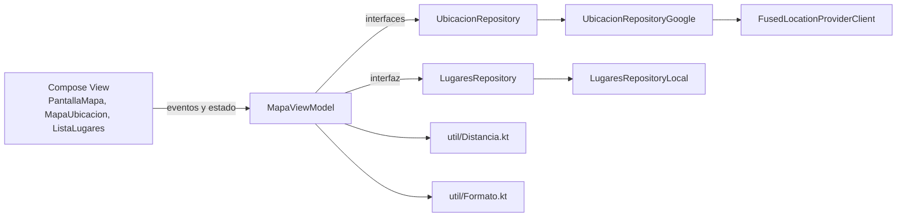
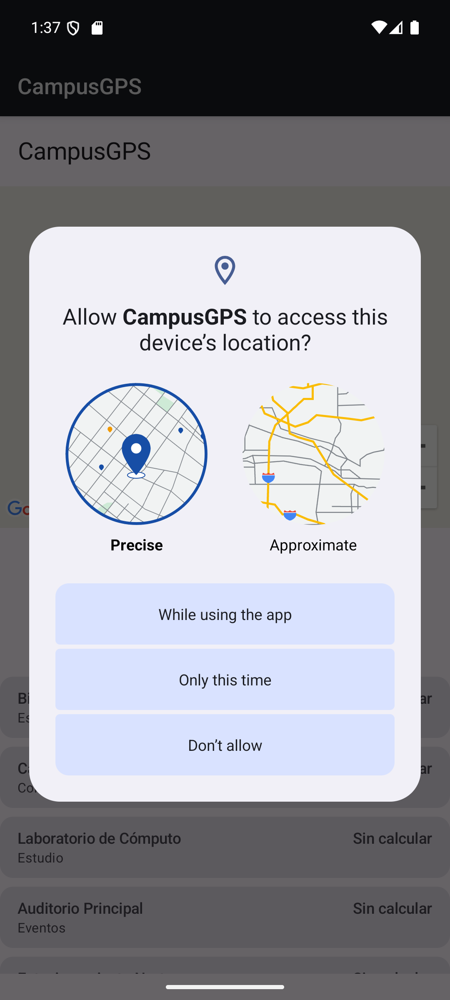
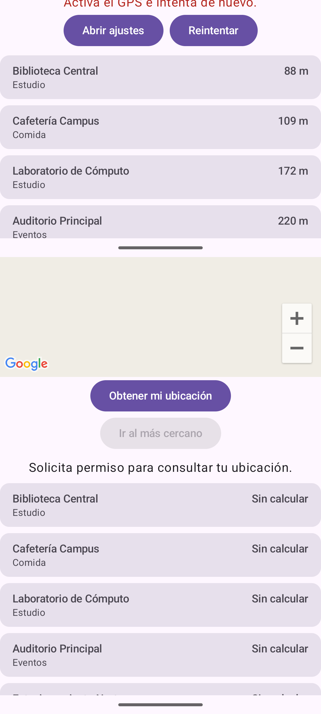
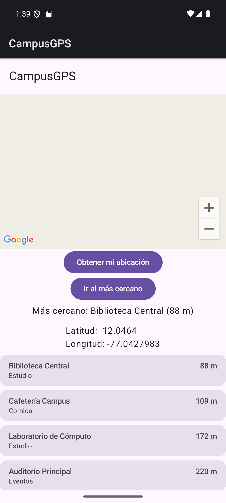

# CampusGPS

CampusGPS muestra la ubicación del usuario y cinco lugares ficticios de un campus en un mapa. Después de obtener la ubicación, ordena los lugares por distancia y permite seleccionar uno o navegar al más cercano.

## Configuración

1. Abre el proyecto en Android Studio y crea una clave de Google Maps con **Maps SDK for Android** habilitado.
2. Agrega la clave localmente a `local.properties` (ese archivo está ignorado por Git):

   ```properties
   MAPS_API_KEY=CLAVE_DE_GOOGLE_MAPS
   ```

3. Sincroniza Gradle, selecciona un emulador con Google Play y ejecuta `app`.
4. Para probar el campus, configura la ubicación del emulador cerca de `-12.0464, -77.0428`.

La clave no se incluye en el proyecto ni en el repositorio. Sin una clave válida, el SDK muestra el fondo del mapa vacío y no se pueden verificar visualmente sus marcadores ni sus mosaicos. Las capturas actuales se hicieron con el AVD Pixel 8; la clave local estaba vacía durante esa ejecución.

## Estructura de paquetes

```text
app/src/main/java/com/davila/campusgps/
├── MainActivity.kt
├── data/
│   ├── LugaresRepository.kt
│   ├── LugaresRepositoryLocal.kt
│   ├── UbicacionRepository.kt
│   └── UbicacionRepositoryGoogle.kt
├── model/
│   └── Modelos.kt
├── ui/
│   ├── ListaLugares.kt
│   ├── MapaUbicacion.kt
│   ├── MensajeError.kt
│   └── PantallaMapa.kt
├── util/
│   ├── Distancia.kt
│   └── Formato.kt
└── viewmodel/
    ├── CampusViewModelFactory.kt
    └── MapaViewModel.kt
```

## Diagrama MVVM + Repository



La View solo recoge acciones y representa el estado. El ViewModel no recibe `Context`; solicita información a interfaces Repository y calcula distancias mediante `util`. El acceso a Android y Google Play Services queda en el Repository.

## Capturas

### Solicitud de permiso



### Mapa y ubicación actual

La pantalla obtuvo `-12.0464, -77.0428`; el mapa aparece vacío por no tener una API Key configurada durante la captura.


### Marcadores del campus

La API Key vacía impide que Google Maps renderice los mosaicos y marcadores; esta captura documenta la pantalla del mapa, pero no acredita la visualización de los cinco marcadores.



### Lista ordenada por distancia

Ubicación de prueba: punto base del laboratorio. La Biblioteca Central quedó a 88 m y la Cafetería Campus a 109 m.



### Error de GPS apagado


## Pruebas de aceptación

| Comprobación | Resultado observado |
|---|---|
| La app abre y solicita permiso | Verificado en Pixel 8 AVD |
| Permitir ubicación | Verificado: se obtuvo ubicación y se actualizaron las distancias |
| Negar permiso y abrir ajustes | Implementado; falta repetir manualmente esta prueba |
| Cargar cinco marcadores en Google Maps | Pendiente: configurar una API Key válida |
| Tocar un marcador y ver título/categoría | Pendiente: configurar una API Key válida |
| Ordenar lista y mostrar metros | Verificado en AVD |
| Seleccionar tarjeta y mover la cámara | La interacción está implementada; pendiente de comprobación visual con API Key |
| Ir al más cercano y deshabilitarlo antes de buscar | Estado y selección verificados parcialmente; mapa pendiente de API Key |
| Cambiar ubicación y buscar otra vez | Pendiente de repetición manual |
| Apagar GPS y reintentar | Verificado: se muestra el mensaje de GPS |
| Rotar sin perder el estado | Pendiente de repetición manual |
| Revisar que la clave no esté en Git y `local.properties` esté ignorado | Verificado en la configuración del proyecto |

## Para pensar

1. **¿Por qué `FusedLocationProviderClient` está dentro del Repository y no en el ViewModel?**  
   Es un servicio de plataforma que depende de Android y del contexto. El Repository encapsula ese acceso y el ViewModel consume una interfaz sencilla, sin depender de `Context`; así también es más fácil sustituir el origen de ubicación en pruebas.

2. **¿Qué diferencia hay entre el permiso de ubicación y la clave de API de Maps? ¿Qué pasa si falta cada uno?**  
   El permiso autoriza a la app a leer la ubicación del dispositivo. La clave autoriza al SDK de Google Maps a usar el servicio de mapas del proyecto de Google Cloud. Sin permiso, no se obtiene la ubicación; sin clave válida, el mapa puede quedar vacío aunque la app tenga permiso de ubicación.

3. **¿Por qué la clave va en `local.properties` y no en el código? ¿Qué harías si se subiera a GitHub por error?**  
   `local.properties` se excluye de Git para evitar incluir accidentalmente la clave en los commits. Si se publica, la revocaría o rotaría en Google Cloud, revisaría el historial y las restricciones de la nueva clave, y dejaría de usar la expuesta.

4. **¿Dónde calculas la distancia y por qué no en el Composable?**  
   La conversión y el cálculo están en `util/Distancia.kt` y `util/Formato.kt`; el ViewModel actualiza y ordena los lugares. Los Composables solo representan el estado, lo que evita lógica de negocio en la interfaz.

5. **¿Qué pasa con tu app si el usuario niega el permiso dos veces? ¿Cómo lo manejas?**  
   La app conserva la pantalla y representa el estado de permiso denegado sin cerrarse. El botón **Abrir ajustes** lleva a los ajustes de CampusGPS para que el usuario pueda habilitar la ubicación si el sistema ya no vuelve a mostrar el diálogo.
