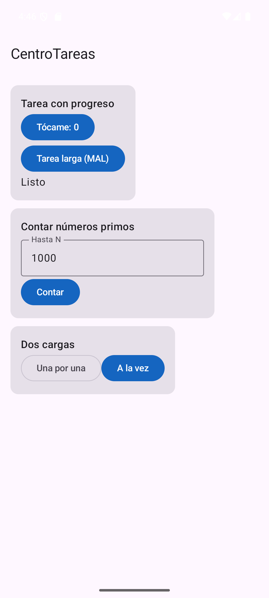
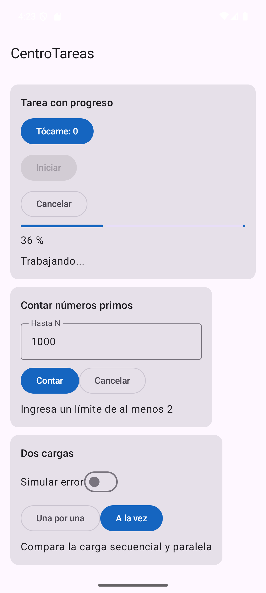
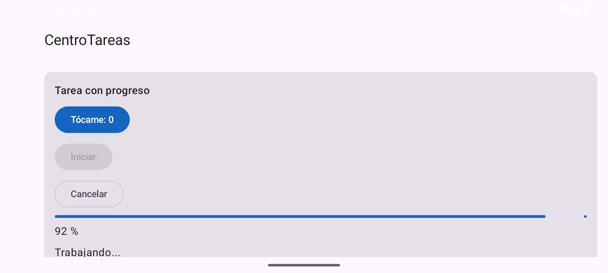
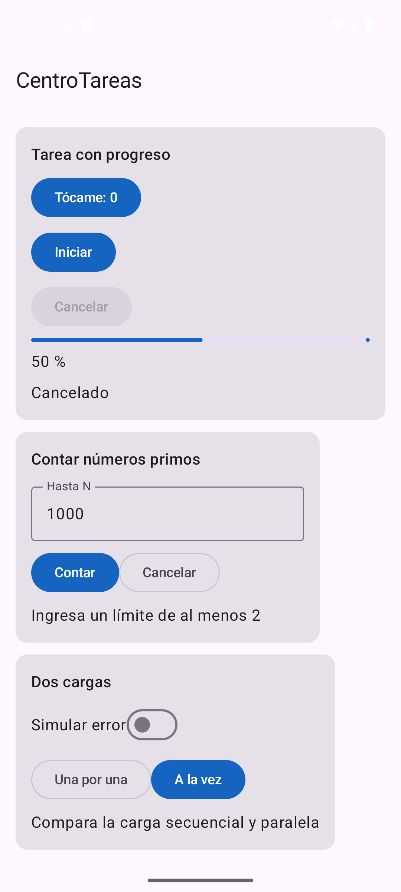
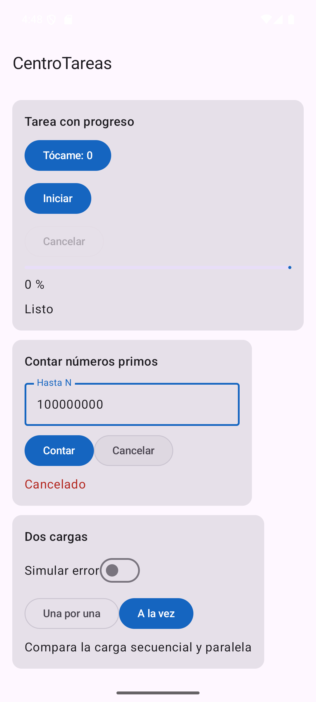
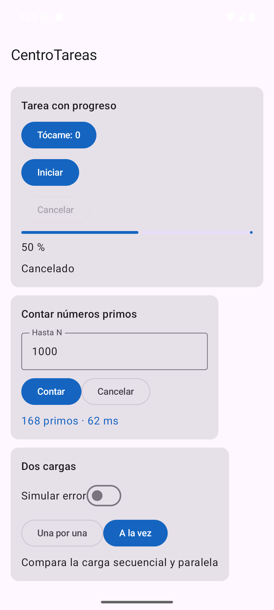
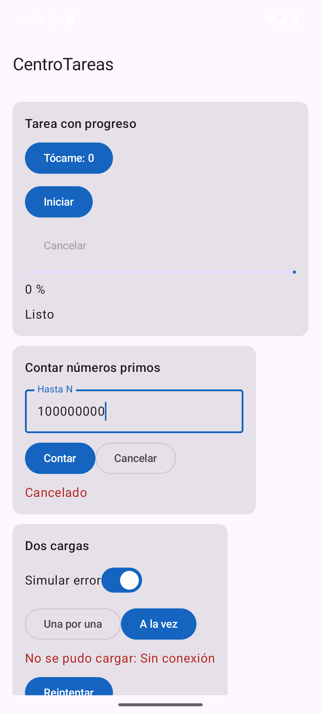

# CentroTareas

Aplicación Android didáctica del Laboratorio 14 de Programación en Móviles. Muestra cómo mantener la interfaz disponible al ejecutar tareas demoradas, calcular primos y comparar cargas secuenciales y paralelas.

> **Base del proyecto:** no se encontró un starter de CentroTareas en Semana14, en las ramas inspeccionadas ni en las ubicaciones locales consultadas. Por eso, el esqueleto de `codigo-mio` se creó siguiendo los contratos y archivos descritos en el PDF; no se presenta como copia del proyecto entregado por el docente.
>
> **Trazabilidad:** esta implementación fue realizada con asistencia de Codex durante la sesión. `codigo-mio` conserva los pasos/commits de la Fase 1 del laboratorio, pero no sería correcto afirmar que el código se produjo sin IA.

## Tecnologías

- Kotlin y Android Gradle Plugin.
- Jetpack Compose y Material 3 (interfaz declarativa, sin layouts XML).
- MVVM con `ViewModel`, `StateFlow` y `viewModelScope`.
- Kotlin Coroutines: `withContext`, `Dispatchers.Default`, `Job`, `async`, `await`, `delay`.
- Repository (`TareasRepository`) y una implementación local con datos ficticios.
- JUnit 4 y `kotlinx-coroutines-test` para verificar el conteo de primos.

## Funcionalidades

1. Paso histórico: `tareaLargaMala()` usó `Thread.sleep(4000)` en el hilo principal para demostrar el congelamiento. La implementación se retiró en el paso siguiente.
2. `tareaLarga()` simula cuatro segundos en `Dispatchers.Default`, informa los hilos con `Log.d("HILO", ...)` y mantiene activo el contador de toques.
3. Progreso de 0 a 100 % expuesto como `StateFlow<Float>`.
4. Cancelación por `Job`, con prevención de doble inicio y estado final en `finally`.
5. Conteo cancelable de primos en `Dispatchers.Default`, comprobando cancelación en el bucle.
6. Cargas de perfil/pedidos de forma secuencial (aprox. 5 s) y paralela con `async/await` (aprox. 3 s).
7. Error simulado `IOException("Sin conexión")`, estado de error visible y reintento manual.

## Arquitectura

```text
PantallaTareas (Compose)
       │ eventos / collectAsState
       ▼
TareasViewModel ── StateFlow de estados de pantalla
       │ depende de la interfaz
       ▼
TareasRepository ◀── TareasRepositoryLocal
                         ├─ demoras ficticias
                         └─ conteo de primos cancelable
```

La View solo presenta el estado y envía eventos. El ViewModel coordina corrutinas y estado sin `Context`. El Repository realiza las cargas ficticias y el cálculo de primos. La cancelación se vuelve a lanzar para conservar la semántica cooperativa.

## Observación del Paso 1

Se ejecutó la APK construida desde el commit histórico del paso 1 (`71ea6af`), que contiene `tareaLargaMala()` y `Thread.sleep(4000)`. Mientras la llamada bloqueaba el hilo principal, la pantalla mantuvo el estado anterior (`Listo`) y el contador permaneció en 0; no apareció `Trabajando...` y el toque a «Tócame» quedó pendiente. Al terminar los cuatro segundos se mostró `Terminó` y se procesó el toque, dejando el contador en 1. Las capturas `paso1-congelado.png` y `paso1-despues.png` documentan ambos estados.

La espera de diez segundos no se ejecutó. Por inferencia, una espera así podría provocar el aviso ANR («La aplicación no responde»); no se presenta como resultado observado.

## Capturas reales del emulador

Las imágenes se tomaron desde el emulador Android. Los tiempos dependen del dispositivo.

### Congelamiento del paso 1




### Tarea con progreso y contador responsivo




### Rotación de pantalla durante la tarea




### Cancelación





### Conteo de primos (1000 → 168)



### Comparación de cargas

Secuencial: 5039 ms.


Paralela: 3005 ms.


### Error y recuperación



Después de desactivar la simulación y pulsar Reintentar, la carga paralela finalizó correctamente en 3007 ms.

## Pruebas de aceptación

| Prueba | Resultado esperado | Resultado observado |
|---|---|---|
| Paso 1, espera de 4 s | La UI se congela; no se ve Trabajando; el toque se atiende al final | Verificado en APK histórica; capturas antes/después. No se probó 10 s |
| Contador durante tarea en corrutina | Sigue respondiendo | Verificado: contador 1 mientras el progreso estaba en 35 % |
| Logcat `HILO` | main / DefaultDispatcher-worker / main | Verificado: `Antes: main`, `Dentro: DefaultDispatcher-worker-1`, `Después: main` |
| Progreso | 0–100 % en aprox. 4 s | Verificado; 92 % durante rotación y 100 % al finalizar |
| Cancelar tarea de progreso | Detiene, conserva el porcentaje y permite iniciar de nuevo | Verificado al 50 % |
| Pulsar Iniciar dos veces | No crea dos tareas | Verificado: un solo evento Antes/Dentro/Después |
| Primos 100 / 1000 / 10000 | 25 / 168 / 1229 | Verificado con pruebas unitarias; 1000 también en emulador |
| Primos con N grande | No congela y se puede cancelar | Verificado con N=100000000 y cancelación desde la UI |
| Cargas | Secuencial ≈ 5 s; paralela ≈ 3 s | Verificado: 5039 ms y 3005 ms |
| Error + Reintentar | Error visible; al desactivar error, éxito | Verificado: `Sin conexión`, luego éxito en 3007 ms |
| Rotar durante tarea | El trabajo y el progreso continúan | Verificado: 92 % en horizontal y 100 % al volver a vertical |
| Código final | Sin `GlobalScope`, `runBlocking` ni `Thread.sleep` | Verificado en archivos Kotlin finales; `Thread.sleep` aparece solo en el commit histórico del paso 1 |
## Para pensar

1. **¿Por qué no se veía Trabajando... en el Paso 1?** Porque la asignación actualiza el estado, pero el hilo principal queda bloqueado antes de que Compose pueda dibujar el siguiente frame.
2. **¿Qué diferencia hay entre Thread.sleep y delay?** `Thread.sleep` bloquea el hilo que lo ejecuta. `delay` suspende la corrutina y libera el hilo para atender otras tareas.
3. **¿Por qué Dispatchers.Default para los primos y Dispatchers.IO para la red?** El conteo es trabajo intensivo de CPU y encaja con `Default`; operaciones de entrada/salida esperan recursos externos y normalmente usan `IO`. En este laboratorio, las cargas son simuladas con `delay`, no hacen red real.
4. **¿Qué pasaría si el usuario cierra la pantalla? ¿Qué papel cumple viewModelScope?** Al destruirse el ViewModel se cancela su `viewModelScope` y las tareas cooperativas vinculadas a él; así no siguen trabajando sin dueño de UI.
5. **¿Por qué async tarda 3 s y no 5 s? ¿Qué pasa si una de las dos cargas falla?** Las dos tareas se inician a la vez y el total se aproxima a la más larga: `max(2 s, 3 s)`. En un `coroutineScope`, un fallo cancela la tarea hermana y se propaga al ViewModel, que lo presenta como error sin cerrar la app.

## Compilar y probar

En Windows, con Android SDK instalado y disponible en `ANDROID_HOME`:

```powershell
.\gradlew.bat assembleDebug
.\gradlew.bat testDebugUnitTest
```

APK: `app/build/outputs/apk/debug/app-debug.apk`.
