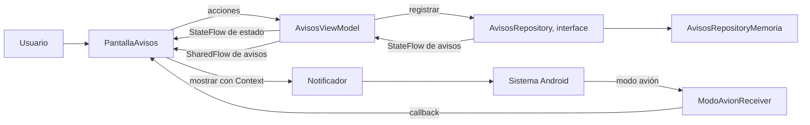
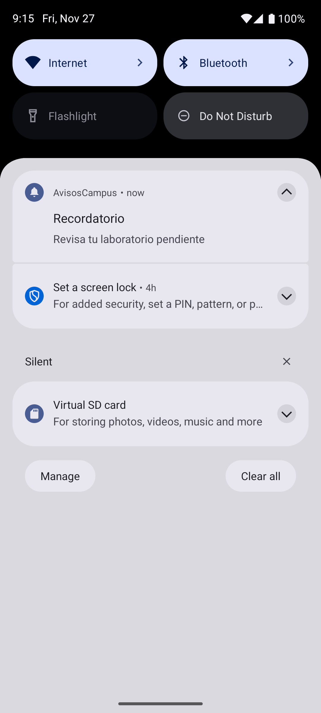
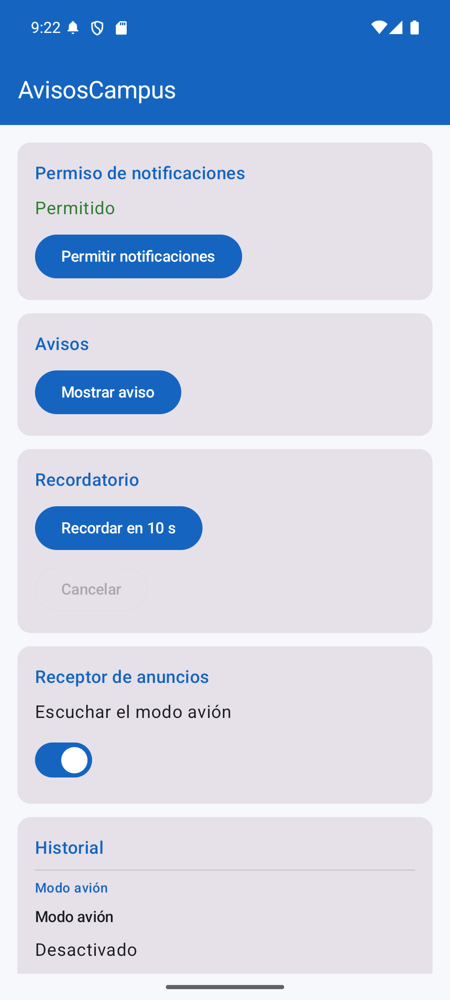

# AvisosCampus

Aplicación Android local en Kotlin, Jetpack Compose y Material 3. Permite solicitar el permiso de notificaciones, mostrar avisos, programar un recordatorio de 10 segundos con cancelación, escuchar cambios del modo avión y consultar un historial en memoria. Usa datos ficticios y no requiere internet.

## Estructura

```text
app/src/main/java/com/davila/avisoscampus/
├── AvisosApp.kt                 Application y canal Avisos
├── MainActivity.kt              Entrada de Compose
├── model/Modelos.kt             Aviso, Origen y PermisoUi
├── data/AvisosRepository.kt     Interface y almacenamiento en memoria
├── notificacion/Notificador.kt  Canal, permiso y NotificationCompat
├── receiver/ModoAvionReceiver.kt
├── viewmodel/
│   ├── AvisosViewModel.kt
│   └── AvisosViewModelFactory.kt
└── ui/
    ├── PantallaAvisos.kt
    ├── HistorialAvisos.kt
    └── theme/Theme.kt
```

## Arquitectura MVVM



El ViewModel no utiliza `Context`, `NotificationManager` ni `BroadcastReceiver`. La pantalla registra el receptor solo mientras el switch está activo y lo libera en `onDispose`. El historial reside en el Repository en memoria; se mantiene durante una rotación, pero se pierde al cerrar el proceso de la app.

## Capturas reales

Obtenidas en el emulador Pixel_8 con Android API 35.

### Notificación en el panel


### Recordatorio



### Modo avión



### Historial


### Permiso denegado


## Pruebas de aceptación

| N.º | Prueba | Resultado observado |
| --- | --- | --- |
| 1 | Canal en Ajustes | OK: aparece «Avisos». |
| 2 | Solicitar permiso | OK: apareció el diálogo de Android y cambió la etiqueta. |
| 3 | Mostrar aviso | OK: apareció «Tarea lista». |
| 4 | Dos avisos | OK: se observaron dos notificaciones con identificadores distintos. |
| 5 | Tocar notificación | OK: abrió MainActivity y desapareció la notificación tocada. |
| 6 | Recordatorio de 10 s | OK: hubo cuenta regresiva y llegó «Recordatorio». |
| 7 | Minimizar durante cuenta | OK: llegó el aviso con la app minimizada. |
| 8 | Cancelar recordatorio | OK: la cuenta se desactivó y no apareció un aviso nuevo. |
| 9 | Switch activo y modo avión | OK: se registraron «Activado» y «Desactivado». |
| 10 | Switch inactivo y modo avión | OK: no se añadieron avisos tras los cambios. |
| 11 | Permiso denegado | OK: mensaje visible, aviso en historial y app abierta. |
| 12 | Rotar durante la cuenta | OK: la cuenta continuó en horizontal; [captura adicional](capturas/rotacion-recordatorio.png). |
| 13 | Revisión de arquitectura | OK: no hay `Context` en `viewmodel/` y el registro tiene `unregisterReceiver` en `onDispose`. |

Compilación comprobada con `./gradlew :app:assembleDebug`.

## Para pensar

1. **¿Por qué canal y permiso?** En Android 8+ el canal clasifica las notificaciones y permite al usuario controlar su importancia; sin canal, una notificación destinada a él no se muestra. En Android 13+ también se necesita autorización `POST_NOTIFICATIONS`; si se deniega, la app no puede publicar avisos normales, aunque sí conservarlos en su historial.
2. **¿Por qué el ViewModel emite un evento?** Decide el contenido y lo registra sin depender del sistema Android. La pantalla recibe el evento y usa `Context` para notificar, lo que mantiene el ViewModel independiente y comprobable.
3. **¿Qué ocurre si se repite un id?** `notify` actualiza o reemplaza la notificación anterior con ese id; usar `aviso.id` permite mantener avisos separados.
4. **¿Por qué `onReceive` corto y liberar el receptor?** El sistema espera que el callback termine pronto; el trabajo largo puede bloquear la app. Un receptor registrado que no se libera mantiene referencias innecesarias y puede recibir eventos fuera de la vida útil de la pantalla.
5. **¿Cuándo local y cuándo push?** Una local sirve para eventos calculados en el propio dispositivo, como el recordatorio o el modo avión. Una push de Firebase sirve para mensajes originados en un servidor, por ejemplo un aviso nuevo del campus para varios usuarios; requiere red e infraestructura externa.
